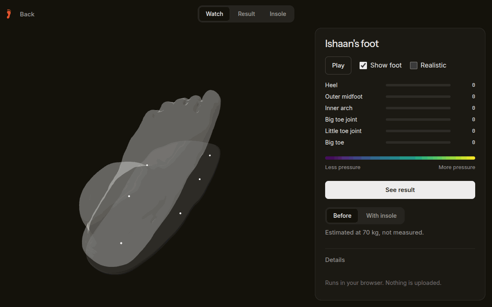
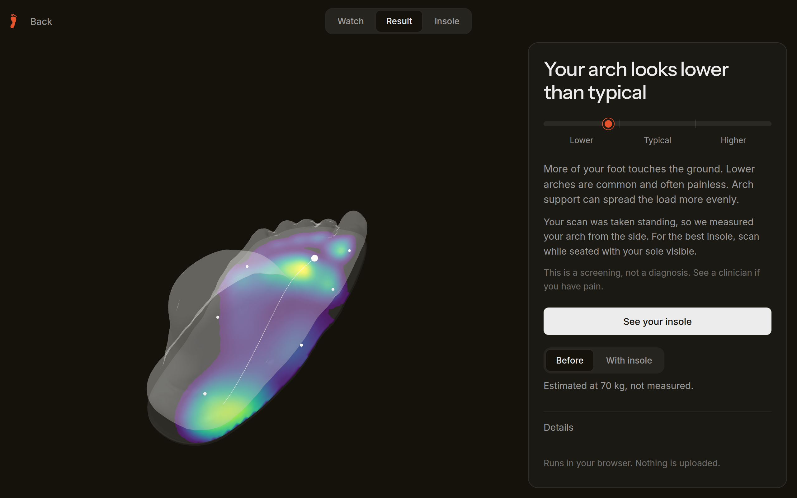
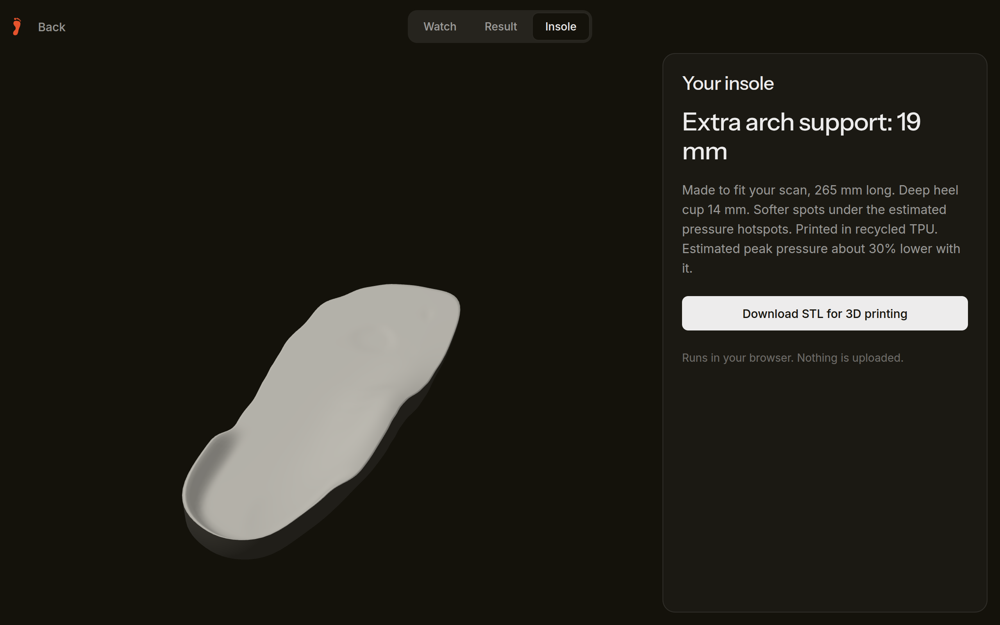
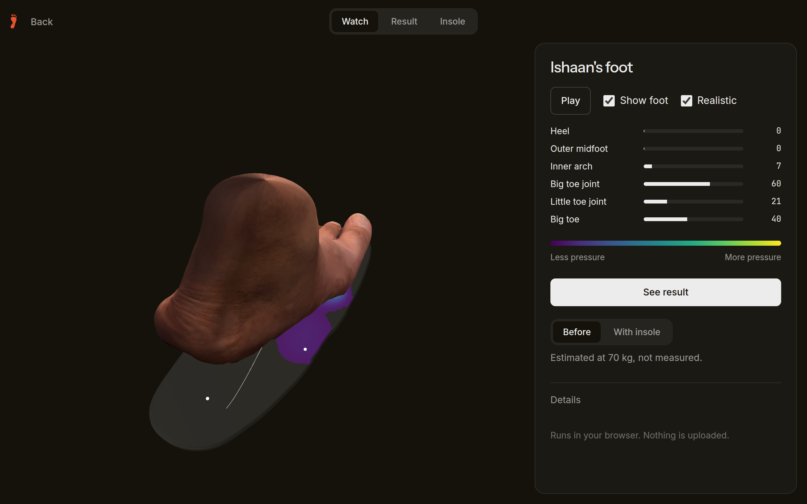
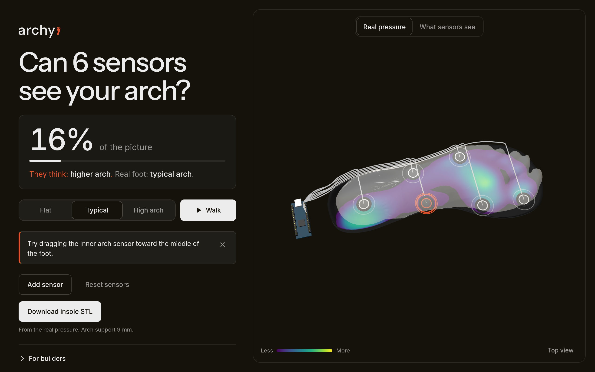

# archy

Check your arch. Print your insole.



Try it at **[tryarchy.vercel.app](https://tryarchy.vercel.app)**. It runs in your browser and uploads nothing.

Scan your foot with an iPhone, or tape six cheap pressure sensors to an insole and walk. archy measures your arch, shows where you carry your weight, and builds a custom insole as an STL you can send straight to a 3D printer. Built at DubHacks '26.

| | |
| --- | --- |
|  |  |
| Arch result in plain words, with the pressure map under the foot. | The insole: heel cup, arch support sized to your foot, softer spots under hotspots. |
|  |  |
| The real iPhone scan, textured. | The sandbox. Drag sensors around a foot to see how much six of them can see. |

## How it works

1. **Input.** An iPhone LiDAR scan exported as a millimeter STL, or a ~$40 kit of six force sensors on an Arduino streaming over Web Serial.
2. **Pressure map.** Sensor readings are interpolated onto a 2.5 mm grid inside the foot outline. A scan has no sensors, so its pressure is estimated from its shape and body weight.
3. **Arch reading.** Arch Height Index from the scan (Butler 2008), or the Cavanagh arch index from the footprint. The result reads as lower, typical or higher.
4. **Insole.** A 3 mm base, heel cup, medial arch support scaled from the arch reading, and 1.2 mm of relief under pressure hotspots, written out as a binary STL.

The core math lives in `sim/src/core` with no DOM or three.js imports, so it can move to Swift.

## Repo

| Path | What |
| --- | --- |
| `sim/` | The web demo. Pressure sensors to heatmap to arch result to printable insole. |
| `ios/` | The iPhone app: onboarding, LiDAR foot scan, hand measurements, insole design, foot training. |
| `hardware/` | The 6-sensor DIY pressure insole: parts list, wiring and firmware. |
| `datasets/` | Fetch, validation and analysis scripts for the open foot datasets below. |
| `services/voice/` | Optional narration proxy for the app's read-aloud. |
| `docs/` | Research notes and the [agent workflow](docs/agent-workflow.md) we built this with. |

## Run it

```sh
cd sim && bun install && bun run dev      # web demo on http://localhost:5173
```

For the iPhone app, open `ios/Archy.xcodeproj` and run the **Archy** scheme. It needs iOS 26, and scanning needs an iPhone with LiDAR. To build the sensor kit, follow [`hardware/README.md`](hardware/README.md).

## Limits

- This is a screening demo, not a diagnosis. The indices are not clinically validated.
- Pressure for a scanned foot is estimated, never measured.
- Six sensors can't measure contact width, so the kit reports the arch index alone.
- The iPhone scan doesn't sync to the web demo yet. Export the STL and upload it.

## Data

| Dataset | Used for | License |
| --- | --- | --- |
| [Plantar pressure insoles](https://doi.org/10.5281/zenodo.21743536), 14 adults, 48 sensors | Lab insole walks | CC BY 4.0 |
| [MUN104](https://github.com/0todd0000/mun104), Pataky et al. 2011 | Healthy pressure template | MIT |
| [Foot shape-function scans](https://doi.org/10.5061/dryad.g4f4qrfwt), Schuster et al. 2024 | Example 3D feet | CC0 |
| [CAD WALK](https://doi.org/10.5281/zenodo.1265420), Booth et al. 2019 | Clinic plate steps | Zenodo says CC BY 4.0, the bundled readme says CC BY-NC-SA. Treat it as non-commercial. |

The three team foot scans are ours, shared with permission.

## Team

- Ishaan Kothari ([GitHub](https://github.com/ishaanko), [LinkedIn](https://www.linkedin.com/in/ishaanko/))
- Pranav Narsipur ([GitHub](https://github.com/ranium1), [LinkedIn](https://www.linkedin.com/in/pranav-narsipur/))
- Prakhar Tiwari ([GitHub](https://github.com/Prakhar-Tiwari-0), [LinkedIn](https://www.linkedin.com/in/prakhartiw/))

## License

Code is [MIT](LICENSE). The datasets above keep their own licenses. Instrument Sans is under the SIL OFL 1.1.
